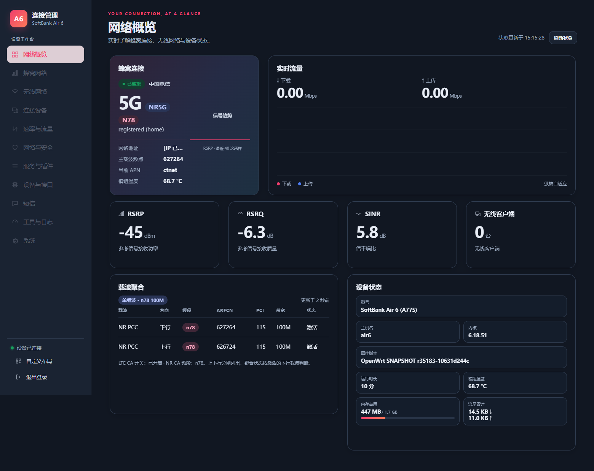
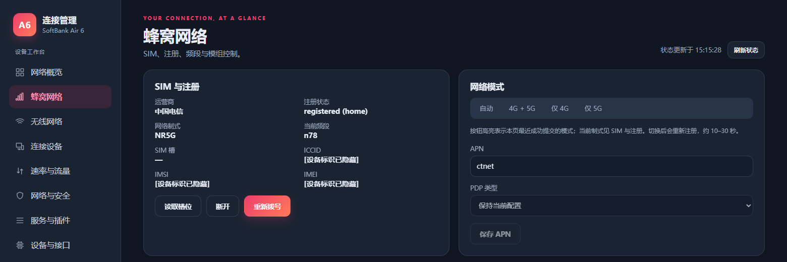

# SoftBank Air 6 (软银 Air6 / A775) — P54 modem research

**English** | [简体中文](README.zh-CN.md)

An authorization-free public subset of P54 modem frequency metadata migration specifically for the **SoftBank Air 6 (软银 Air6 / A775)** home router, using the Quectel RG620T-SBK modem. No device-bound licensing logic, fingerprint implementation, authorization hooks, issuer keys, vendor signing SDK/tool, signer executable or ready-to-flash release package is included.

## Band unlocking / expansion targets

This project migrates P54 modem band metadata for **SoftBank Air 6 (A775)**. The target set contains **12 LTE bands + 13 NR bands: 25 RAT-specific band entries**:

| RAT | Count | Target bands |
| --- | --- | --- |
| LTE / 4G | 12 | B1, B3, B5, B7, B8, B20, B28, B38, B40, B41, B42, B43 |
| NR / 5G | 13 | n1, n3, n5, n7, n8, n20, n28, n38, n40, n41, n77, n78, n79 |

“Unlocking” here means migrating and expanding permitted band metadata. It does not mean removing a SIM/operator network lock or implementing device-bound licensing. LTE B1 and NR n1 are counted separately. These 25 entries do not imply simultaneous operation or 25-carrier aggregation.

The public version excludes device-bound licensing and authorization hooks; building requires no fingerprint or unlock code. Run `python3 test.py` as documented below to produce and check `build/modem-unsigned.img`. The result still requires independent vendor signing and hardware validation; it is not a signed package accepted by the web updater.

This is a migration target list, not a claim that every band has passed RF/network testing. Availability depends on board RF hardware, calibration, antennas, SIM, coverage and applicable local requirements. The n78 screenshots show the private reference version; this public authorization-free experiment has not been device validated. **CA remains unsupported.** Contact the maintainer through Issues for assistance signing candidate modem images; tools and private keys remain private.

## CA is not supported yet — contributors welcome

**Carrier aggregation (CA) is currently unsupported in this public experiment; no CA combination is promised to work.** Preserving original CA metadata does not establish implemented, enabled or network-validated CA behavior.

Available devices, SIMs, network environments and testing time are limited. Contributors are welcome to continue CA, NR/LTE combinations, RF and long-term stability research. Submit reproducible code and redacted test reports through Issues / Pull Requests, including operator, RAT, bands, widths, image hashes and steps. A UI indicator alone is not evidence of active aggregation.

**The maintainer can help sign candidate modem images for device testing.** Contact [hchyhchyxh](https://github.com/hchyhchyxh) through repository Issues to discuss candidates and tests. Signing tools and private keys remain private. A signature does not guarantee boot acceptance or CA functionality.

## Included scripts

- `metadata/audit_migration.py`: parse and validate md1rom/md1drdi container sections.
- `metadata/build_p54_eu25.py`: preserve original P54 nodes, migrate donor metadata and generate ROM/DRDI drafts with change records.
- `metadata/emit_unsigned.py`: apply pinned BSS array mappings, rebuild section hashes and CHECK_HEADER, and emit an unsigned research image without authorization runtime/hooks.
- `build.py`: run draft generation and image assembly in order.
- `test.py`: check pinned inputs, build output and unchanged original runtime entry points; verify no private authorization runtime is injected.
- JSON files: record layouts, NR graphs, migration plans and input hashes.

## Included reference inputs

The owner explicitly requested inclusion of these pinned fixtures:

```text
metadata/sb_rudolf_v1.01.85_single/modem-verified.img
fullband_eu_bucket_order_fix_20mhz/modem.img
fullband_eu_bucket_order_fix_20mhz/manifest.json
```

Reference firmware retains its original provenance and licensing. The MIT license on original project scripts does not relicense vendor firmware. `inputs.lock.json` records hashes; its `.gz` names refer to original archives, while tests check decompressed reference content.

## Build and test

Python 3 is required. The private signing SDK is not required:

```bash
git clone https://github.com/hchyhchyxh/air6-modem.git
cd air6-modem
python3 test.py
# Build only:
python3 build.py
```

Do not use Python `-O` or disable assertions. Outputs are `build/modem-unsigned.img` and `build/report.json`, with intermediate drafts under `metadata/`. Passing these checks is not vendor-signature, secure-boot, RF, CA or long-term stability acceptance. This authorization-free experiment differs from the private licensed modem and has not been flashed or device validated.

## Reference interface

The related [OpenWrt AIR6 project](https://github.com/hchyhchyxh/openwrt-air6) provides the router interface. The following images were captured after real China Telecom **5G n78** registration and data connectivity on November 8, 2026. Device identifiers and addresses are redacted. They show the private reference system's interface and do not establish device validation of this repository's unsigned experiment.





- [Cellular API telemetry: CA, EN-DC and cell measurements](docs/cellular-telemetry-api.md)

- [P54 CA audit / 射频路由与状态检查（2026-11-11）](docs/ca-audit-20261111.md)
