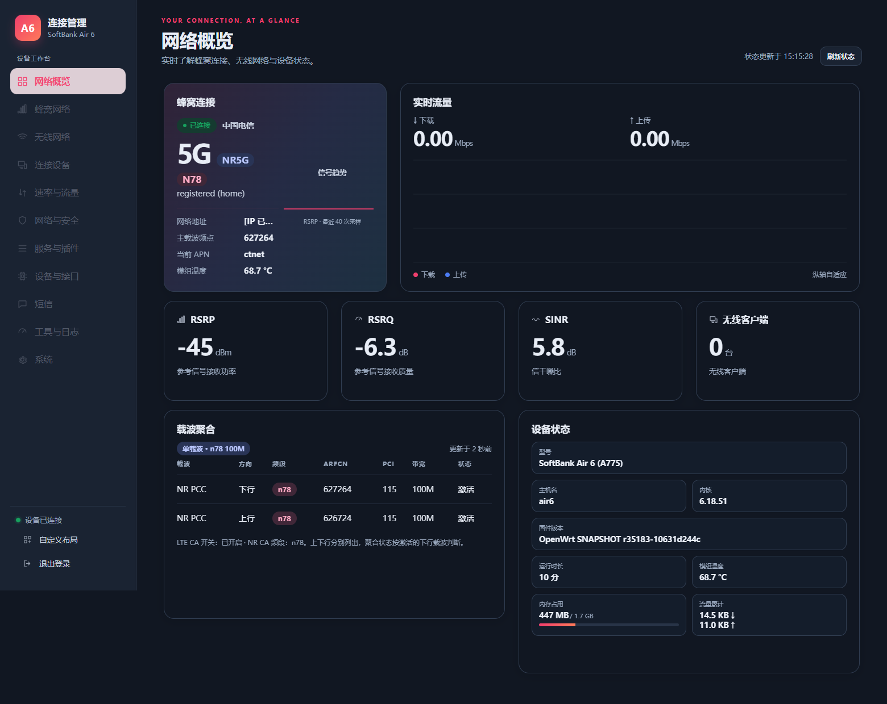
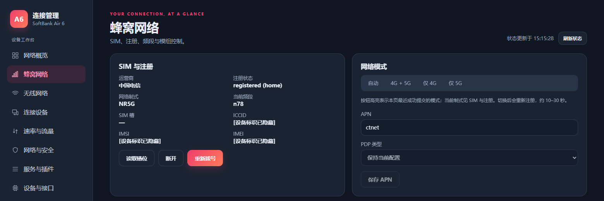

# SoftBank Air 6（软银 Air6 / A775）P54 modem 元数据实验

[English](README.md) | **简体中文**

这是面向日本软银家用路由器 **SoftBank Air 6（软银 Air6，型号 A775）**、移远 RG620T-SBK 模组的 P54 频段元数据迁移去授权公开子集，不含一机一码逻辑、机器码代码、授权 Hook、签发密钥、SDK 签名工具或可直接刷入的发行包。

## CA 暂不支持，欢迎接力

**当前开源实验版本 CA（载波聚合）暂不支持，也不承诺任何 CA 组合可用。** 保留原厂 CA 元数据不等于 CA 已实现或已通过网络验证。

维护者的设备、SIM、网络条件和测试时间有限，希望有人接手继续研究 CA、NR/LTE 组合、RF 和长期稳定性。欢迎在 Issues / Pull Requests 提交可复现代码与去标识化记录，附运营商、制式、频段、带宽、镜像哈希和步骤，不能只根据 UI 图标判断聚合成立。

**维护者可以协助给候选 modem 签名，方便真机测试。** 可通过 Issues 联系 [hchyhchyxh](https://github.com/hchyhchyxh) 商议镜像和测试安排。签名工具和私钥不公开；提供签名不等于保证可启动或 CA 可用。

## 脚本作用

- `metadata/audit_migration.py`：解析、验证 md1rom/md1drdi 容器。
- `metadata/build_p54_eu25.py`：保留 P54 原有节点，迁移 donor 元数据并输出 ROM/DRDI 草稿和变更记录。
- `metadata/emit_unsigned.py`：应用固定 BSS 数组映射、重算段摘要及 CHECK_HEADER，生成不带授权运行时或 Hook 的未签名实验镜像。
- `build.py`：按顺序执行草稿和镜像生成。
- `test.py`：核对输入哈希、构建结果和保持原样的运行时入口，检查没有植入私有授权运行时。
- JSON 文件：记录布局、NR 图、迁移计划与输入哈希。

## 参考输入

按仓库所有者要求，以下三个固定输入已包含在库中：

```text
metadata/sb_rudolf_v1.01.85_single/modem-verified.img
fullband_eu_bucket_order_fix_20mhz/modem.img
fullband_eu_bucket_order_fix_20mhz/manifest.json
```

原始固件的来源和许可保持不变，不因本项目脚本的 MIT 许可而重新许可。`inputs.lock.json` 中的 SHA256 用于核对输入；文件名中的 `.gz` 为原始存档名称，校验的是解压后的参考内容。

## 构建与测试

需要 Python 3，不需要私有签名 SDK：

```bash
git clone https://github.com/hchyhchyxh/air6-modem.git
cd air6-modem
python3 test.py
# 只执行构建：
python3 build.py
```

不要使用 `python -O` 或关闭 assertions。最终实验产物是 `build/modem-unsigned.img` 和 `build/report.json`，中间产物位于 `metadata/`。构建检查通过不等于厂商验签、安全启动、RF、CA 或长期稳定性验收。这个去授权实验版本与私有授权 modem 不同，尚未刷机或真机验证。

## 界面参考

对应的 [OpenWrt AIR6 界面工程](https://github.com/hchyhchyxh/openwrt-air6) 提供路由器管理界面。以下截图在 2026-11-08 真实电信 5G n78 注册并联网后采集，设备标识和地址已遮蔽；它们来自私有参考系统，只展示操作体验，不代表本库未签名实验版本已经通过真机验证。




